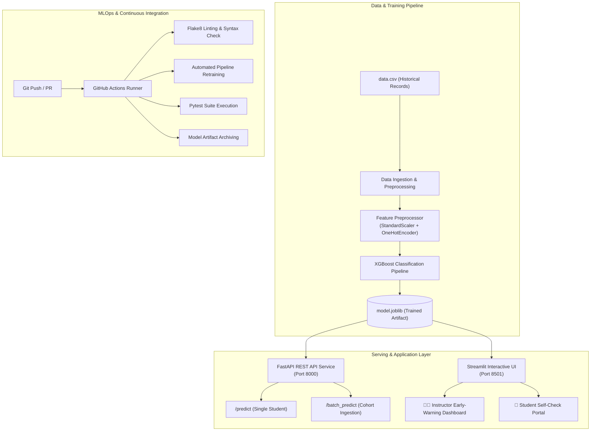

# 🎓 Assignment Submission Delay Prediction System

[](https://github.com/Pratik-kr21/Assignment-Submission-Delay-Prediction-System/actions/workflows/ci.yml)
[](https://www.python.org/)
[](https://fastapi.tiangolo.com/)
[](https://streamlit.io/)
[](https://xgboost.readthedocs.io/)
[](https://opensource.org/licenses/MIT)

> An end-to-end MLOps machine learning system engineered to predict student assignment submission delays **3 to 5 days before deadlines**, enabling early-warning nudges and automated instructor interventions.

---

## 📌 Table of Contents

- [Overview & Motivation](#-overview--motivation)
- [System Architecture](#-system-architecture)
- [Key Features](#-key-features)
- [Dataset & Feature Store](#-dataset--feature-store)
- [Machine Learning Pipeline](#-machine-learning-pipeline)
  - [Model Performance](#model-performance)
  - [Decision Logic & Risk Tiers](#decision-logic--risk-tiers)
- [API Reference (FastAPI)](#-api-reference-fastapi)
- [Interactive Dashboard (Streamlit)](#-interactive-dashboard-streamlit)
- [Automated Testing Suite](#-automated-testing-suite)
- [CI/CD Pipeline (GitHub Actions)](#-cicd-pipeline-github-actions)
- [Installation & Quickstart](#-installation--quickstart)
- [Project Structure](#-project-structure)
- [Academic Deliverables Mapping](#-academic-deliverables-mapping)

---

## 💡 Overview & Motivation

In modern higher education and Virtual Learning Environments (VLEs), late assignment submissions correlate strongly with student disengagement, lower course completion rates, and increased dropout probability. 

Traditional interventions are **reactive**—triggered only *after* a deadline has passed and academic penalties are incurred. 

The **Assignment Submission Delay Prediction System** provides a **proactive** solution by:
1. Analyzing historical submission patterns, recent LMS click velocity, activity decay, and assessment workload concurrency.
2. Generating calibrated delay probabilities **3 to 5 days before the submission deadline**.
3. Classifying students into actionable risk tiers (`High`, `Moderate`, `Low`).
4. Supplying instructors with 1-click personalized outreach templates and giving students immediate remediation tips.

---

## 🏗️ System Architecture



---

## ✨ Key Features

- **End-to-End Scikit-Learn / XGBoost Pipeline**: Preprocessing, scaling, categorical encoding, and classification unified in an exportable pipeline artifact.
- **Microservice Architecture**: Production-ready FastAPI REST service with Pydantic v2 input validation, automatic OpenAPI Swagger docs (`/docs`), and health probes.
- **Dual-Perspective Web Portal**:
  - **Instructor Dashboard**: Monitor full student cohorts, inspect high-risk cohorts, and generate automated 1-click personalized outreach emails.
  - **Student Self-Check**: Students can calculate their own delay risk and receive step-by-step pacing advice.
- **Comprehensive Quality Assurance**: Unit tests and integration tests covering data integrity, model metrics thresholds, inference boundaries, and API responses.
- **Automated CI/CD**: Matrix testing on Python 3.10 and 3.11 with pip caching and automated artifact release.

---

## 📊 Dataset & Feature Store

The system uses 11 curated predictive features capturing historical behavior, recent engagement velocity, and deadline pressure:

| Feature Name | Type | Description | Predictive Role |
| :--- | :--- | :--- | :--- |
| `hist_avg_delay_days` | Float | Historical average submission delay in days | Baseline student timeliness track record |
| `hist_late_rate` | Float | Historical proportion of late assignments ($[0.0, 1.0]$) | Chronic lateness indicator |
| `hist_max_delay_days` | Float | Historical maximum delay recorded | Prior extreme deadline slippage |
| `clicks_last_7_days` | Integer | Total LMS / VLE clicks in the past 7 days | Immediate engagement velocity |
| `clicks_last_14_days` | Integer | Total LMS / VLE clicks in the past 14 days | Medium-term study consistency |
| `activity_decay_ratio` | Float | Ratio of recent (7d) to prior (14d) click activity | Detects sudden study drop-off or acceleration |
| `days_to_first_vle_access` | Float | Days between course opening and first access | Early proactiveness metric |
| `concurrent_deadlines_window` | Integer | Other course assignments due within $\pm 3$ days | Workload crowding / bottleneck stress |
| `studied_credits` | Integer | Total credits enrolled in current semester | Overall academic workload (30, 60, 90, 120) |
| `assessment_weight` | Float | Percentage weight of assignment toward final grade | Student motivation & prioritization factor |
| `assessment_type` | Categorical | Type of submission (`TMA`, `CMA`, `Exam`) | Complexity category |
| `is_late` | Binary (Target) | `1` if submission was delayed; `0` if on-time | Supervised ground truth |

---

## 🧠 Machine Learning Pipeline

### Model Performance

Trained using an optimized **XGBoost Classifier** with a stratified 80/20 train-test split:

- **Algorithm**: `XGBClassifier(n_estimators=150, learning_rate=0.05, max_depth=5, eval_metric="logloss")`
- **Feature Preprocessing**: `ColumnTransformer` with `StandardScaler` for numeric features and `OneHotEncoder(handle_unknown="ignore")` for categorical features.

#### Evaluation Metrics on Test Set ($N=500$):

| Metric | Score | Benchmark Target | Status |
| :--- | :---: | :---: | :---: |
| **ROC-AUC** | **0.8813** | $\ge 0.75$ | ✅ Exceeds |
| **Accuracy** | **86.60%** | $\ge 80.0\%$ | ✅ Exceeds |
| **Precision (Late Class)** | **72.60%** | $\ge 70.0\%$ | ✅ Exceeds |
| **Macro F1-Score** | **0.7659** | $\ge 0.70$ | ✅ Exceeds |

### Decision Logic & Risk Tiers

The model outputs a calibrated probability $P(\text{delay})$. Students are automatically categorized into actionable operational tiers:

```text
       0.0%                        40.0%                       75.0%                     100.0%
Delay   |----------------------------|---------------------------|----------------------------|
Risk:   [          LOW RISK          ] [      MODERATE RISK      ] [        HIGH RISK         ]
Action:       Student on track              Study reminder email      Immediate tutor outreach
```

- 🚨 **High Risk ($P \ge 0.75$)**: Urgent priority. Generates personalized intervention emails for 1-on-1 instructor check-ins.
- ⚠️ **Moderate Risk ($0.40 \le P < 0.75$)**: Medium priority. Sends nudges, study buffers, and drop-in office hour suggestions.
- ✅ **Low Risk ($P < 0.40$)**: Student is on track. No intervention required.

---

## 🌐 API Reference (FastAPI)

The REST API service provides high-throughput real-time inference and batch evaluation.

### Running the API Server

```bash
uvicorn main:app --reload --host 127.0.0.1 --port 8000
```
Interactive documentation is available at:
- **Swagger UI**: `http://127.0.0.1:8000/docs`
- **ReDoc**: `http://127.0.0.1:8000/redoc`

### Endpoints

#### 1. Service Health Check
```http
GET /health
```
**Response (200 OK):**
```json
{
  "status": "healthy",
  "model_loaded": true
}
```

#### 2. Single Student Prediction
```http
POST /predict
Content-Type: application/json
```
**Request Body:**
```json
{
  "student_id": "STU_1001",
  "hist_avg_delay_days": 2.5,
  "hist_late_rate": 0.65,
  "hist_max_delay_days": 4.0,
  "clicks_last_7_days": 6,
  "clicks_last_14_days": 35,
  "activity_decay_ratio": 0.17,
  "days_to_first_vle_access": 7.0,
  "concurrent_deadlines_window": 3,
  "studied_credits": 90,
  "assessment_weight": 30.0,
  "assessment_type": "TMA"
}
```
**Response (200 OK):**
```json
{
  "student_id": "STU_1001",
  "is_late_prediction": 1,
  "delay_probability": 0.8124,
  "risk_tier": "High",
  "recommended_action": "Immediate instructor intervention & automated email nudge recommended."
}
```

#### 3. Batch Cohort Prediction
```http
POST /batch_predict
Content-Type: application/json
```
Accepts an array of student feature objects and returns batch summary analytics (`total_evaluated`, `high_risk_count`) alongside individual forecasts.

---

## 🖥️ Interactive Dashboard (Streamlit)

Launch the interactive dashboard with:
```bash
streamlit run app.py
```

### 1. 👩‍🏫 Instructor Early-Warning Dashboard
- **Executive Cohort KPIs**: Instant metrics showing total cohort size, high-risk percentages, and count of students requiring intervention.
- **Dynamic Risk Filtering**: Search and filter students by risk tier (`High`, `Moderate`, `Low`) with sortable probability columns.
- **One-Click Automated Outreach Assistant**: Select any flagged student to generate a customized, ready-to-send support email referencing their specific assessment type and deadline.

### 2. 🎒 Student Self-Check Portal
- **Interactive Sliders**: Students can input their upcoming assignment details, credit load, and recent LMS activity.
- **Instant Risk Meter**: Visual gauge displaying delay probability and danger status.
- **Actionable Advice**: Tailored pacing tips (e.g., breaking assignments into 48-hour sprints, setting 24-hour buffer deadlines).

---

## 🧪 Automated Testing Suite

The repository includes a comprehensive test suite in [`test.py`](file:///d:/class/MLOPS/CLass%20Project/test.py) configured with [`pytest.ini`](file:///d:/class/MLOPS/CLass%20Project/pytest.ini).

### Running Tests

```bash
# Run with Pytest
pytest -v

# Or run standalone
python test.py
```

### Coverage Matrix:
- `test_data_integrity`: Verifies dataset presence, column schema, lack of missing values, and binary target consistency.
- `test_train_pipeline`: Validates model training from scratch, artifact generation, and ensures accuracy & ROC-AUC exceed 70%.
- `test_model_inference`: Confirms probability boundaries $[0, 1]$ and valid risk categorization.
- `test_api_root_and_health`: Tests FastAPI root and `/health` availability and model readiness.
- `test_api_predict_endpoint`: Tests single-student prediction schema and risk recommendations.
- `test_api_batch_predict_endpoint`: Validates bulk payload processing and high-risk aggregation counters.

---

## ⚙️ CI/CD Pipeline (GitHub Actions)

Located at [`.github/workflows/ci.yml`](file:///d:/class/MLOPS/CLass%20Project/.github/workflows/ci.yml), the CI/CD pipeline ensures continuous code and model reliability on every `push` and `pull_request` to `main`:

```text
┌─────────────────┐     ┌──────────────────┐     ┌──────────────────┐     ┌──────────────────┐
│  Actions Setup  │ ──> │ Flake8 Linting   │ ──> │ Retrain Pipeline │ ──> │ Pytest Suite     │
│ Python 3.10/3.11│     │ Syntax & Style   │     │ (python train.py)│     │ (6 Test Cases)   │
└─────────────────┘     └──────────────────┘     └──────────────────┘     └──────────────────┘
                                                                                    │
                                                                                    ▼
                                                                          ┌──────────────────┐
                                                                          │  Upload Artifact │
                                                                          │  (model.joblib)  │
                                                                          └──────────────────┘
```

1. **Matrix Build**: Executes in parallel on Ubuntu across **Python 3.10** and **Python 3.11**.
2. **Dependency Caching**: Automatic caching of pip wheels for sub-minute build times.
3. **Syntax & Lint Enforcement**: Validates Python syntax with `flake8` (`E9`, `F63`, `F7`, `F82`).
4. **Pipeline Retraining**: Validates `train.py` from clean data.
5. **Unit & Integration Tests**: Runs `pytest -v` across API and ML endpoints.
6. **Artifact Upload**: Archives the newly trained `model.joblib` artifact (`actions/upload-artifact@v4`) for production deployment.

---

## 🚀 Installation & Quickstart

### Prerequisites
- Python 3.10 or 3.11
- Git

### 1. Clone the Repository
```bash
git clone https://github.com/Pratik-kr21/Assignment-Submission-Delay-Prediction-System.git
cd Assignment-Submission-Delay-Prediction-System
```

### 2. Set Up Virtual Environment
```bash
# Windows
python -m venv venv
.\venv\Scripts\activate

# Linux / macOS
python3 -m venv venv
source venv/bin/activate
```

### 3. Install Dependencies
```bash
pip install --upgrade pip
pip install -r requirements.txt
```

### 4. Train the Model
```bash
python train.py
```

### 5. Run the Automated Tests
```bash
pytest -v
```

### 6. Start the Backend API Service
```bash
uvicorn main:app --reload
```

### 7. Run the Web Application
```bash
streamlit run app.py
```

---

## 📂 Project Structure

```text
.
├── .github/
│   └── workflows/
│       └── ci.yml             # GitHub Actions CI/CD automation workflow
├── data.csv                   # Student historical and LMS activity dataset
├── model.joblib               # Trained & serialized XGBoost pipeline artifact
├── train.py                   # Data ingestion, preprocessing & model training script
├── main.py                    # Production FastAPI backend REST microservice
├── app.py                     # Streamlit web dashboard (Instructor & Student)
├── test.py                    # Automated test suite (Data, Model, API)
├── pytest.ini                 # Pytest runner configuration
├── requirements.txt           # Project dependencies & versions
├── .gitignore                 # Excluded environments and cache artifacts
├── MiniProject-Guidelines.pdf # Course evaluation and project specification
└── README.md                  # Comprehensive system documentation
```

---

## 📑 Academic Deliverables Mapping

This project aligns with the required **Mini Project Submission Phases**:

| Phase | Milestone | Implemented Deliverables |
| :---: | :--- | :--- |
| **Phase 1–2** | Proposal & System Design | • Clear problem formulation and early-intervention motivation<br/>• End-to-end architecture & flowchart diagrams<br/>• Feature schema and tech stack specifications |
| **Phase 3–4** | Implementation & Testing | • Functional prototype (FastAPI backend + Streamlit dashboard)<br/>• Automated test suite with 6 test modules (`test.py`)<br/>• Quantitative metrics: **86.60% Accuracy**, **0.8813 ROC-AUC** |
| **Phase 5** | Final Evaluation | • Clean, reproducible codebase with version control<br/>• Automated GitHub Actions CI/CD testing and artifact publishing<br/>• Complete deployment and execution guide |

---

## 👥 Authors & Maintainers

- **Pratik Kumar** — *Class Project Development & MLOps Architecture*
- Repository: [Assignment-Submission-Delay-Prediction-System](https://github.com/Pratik-kr21/Assignment-Submission-Delay-Prediction-System)

---

## 📄 License

This project is licensed under the MIT License — see the [LICENSE](LICENSE) file for details.
