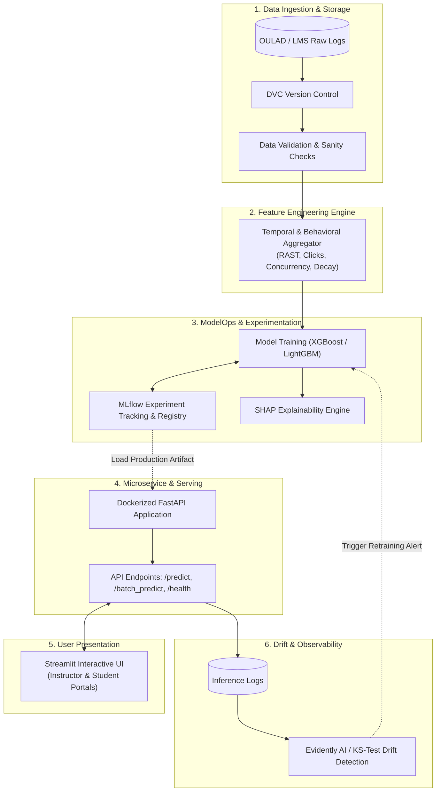
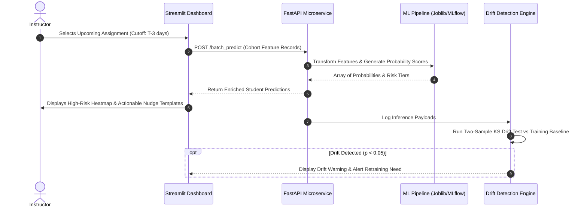
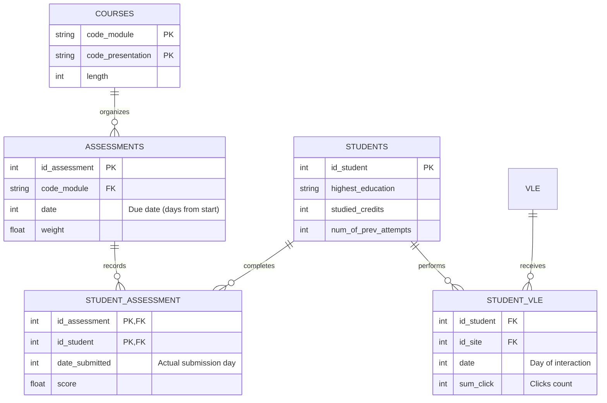
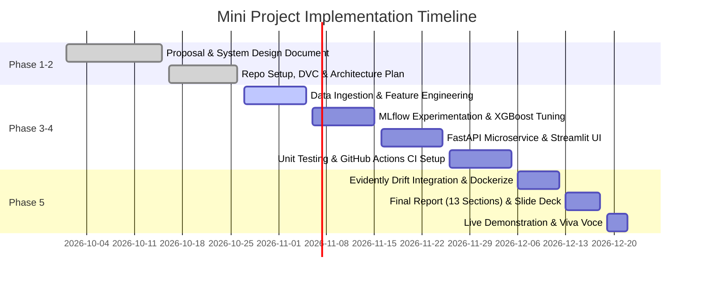

# Mini Project Phase 1–2: Project Proposal & System Design Document

**Course**: Machine Learning Operations (MLOps)  
**Project Title**: Assignment Submission Delay Prediction System  
**Document**: Phase 1–2 Deliverable (Project Proposal, System Architecture & Project Plan)  
**Date**: October 2026  

---

## Part 1: Project Proposal

### 1.1 Project Title
**EduPredict-MLOps: An End-to-End MLOps Platform for Assignment Submission Delay Prediction Using Student Behavioral Logs**

### 1.2 Problem Statement
In higher education institutions and modern online Learning Management Systems (LMS, e.g., Canvas, Moodle, Blackboard), academic procrastination and late assignment submissions are chronic challenges. Late submissions cascade into:
1. Higher course failure rates and increased student dropouts.
2. Inefficient teaching assistant grading cycles and administrative backlogs.
3. Inability for instructors to identify struggling students early enough to make effective interventions.

Currently, academic institutions only observe late submissions **reactively**—after the deadline has passed. There is a lack of automated, predictive **early-warning systems** capable of forecasting submission timeliness prior to deadlines.

### 1.3 Motivation
Educational Data Mining (EDM) demonstrates that a student’s submission timeliness is strongly correlated with their engagement patterns (login frequency, resource downloads, and historical deadline compliance). 
Furthermore, while machine learning models have been studied in educational research, they rarely transition into **production MLOps environments** with version-controlled datasets, experiment tracking, continuous monitoring, and automated deployment. Building an MLOps pipeline for assignment delay prediction bridges this gap by turning static behavioral analytics into a live, observable, and actionable decision-support platform for educators.

### 1.4 Objectives
1. **Develop a Predictive Behavioral Model**: Train and evaluate tree-based ensemble models (XGBoost, LightGBM, Random Forest) on student LMS clickstreams and submission histories to forecast delay risk with high precision and recall.
2. **Build an End-to-End MLOps Pipeline**:
   * Version data and models using **DVC** and **MLflow**.
   * Establish automated data validation using statistical bounds checks.
   * Provide an explainable AI (XAI) layer via **SHAP** to help educators understand risk drivers.
3. **Deploy Containerized Microservices**: Deploy a high-performance **FastAPI** REST inference engine and an interactive **Streamlit** dashboard packaged with **Docker Compose**.
4. **Implement Continuous Monitoring**: Detect real-world data drift and concept drift across academic semesters using **Evidently AI** and Kolmogorov-Smirnov statistical tests.

### 1.5 Scope of the Project
* **In Scope**:
  * Tabular and time-windowed clickstream logs from university courses (using the Open University Learning Analytics Dataset - OULAD).
  * Feature engineering at a pre-deadline observation cutoff window ($T_{\text{deadline}} - 3 \text{ days}$).
  * Binary and risk-tier categorization (Low, Moderate, High risk).
  * REST API endpoints for real-time and batch scoring.
  * Interactive Instructor and Student portals with automated intervention email generation.
  * Concept drift alerting for data shifts across semesters.
* **Out of Scope**:
  * Natural Language Processing analysis of raw assignment code or text content.
  * Direct bidirectional database writes back into proprietary university SIS (simulated via API and mock LMS data).

### 1.6 Proposed Solution / Methodology
1. **Data Ingestion & Versioning**: Ingest historical student interaction tables from the OULAD benchmark; version datasets with DVC.
2. **Feature Engineering**: Compute Relative Assignment Submission Time (RAST), historical delay tendencies, recent 7-day LMS activity, clickstream decay ratios, and concurrent deadline pressures.
3. **Model Training & Experimentation**: Orchestrate cross-validation using MLflow to track parameters, F1-scores, and PR-AUC. Register the top-performing model artifact into the MLflow Model Registry.
4. **Inference & Serving**: Expose the pipeline via FastAPI. Provide `/predict` for single-student lookups and `/batch_predict` for cohort screening.
5. **Human-in-the-Loop Dashboard**: Present predictions in Streamlit, categorizing students into actionable tiers (Low, Moderate, High) and generating tailored guidance templates.
6. **Observability**: Run periodic drift checks on incoming batches to flag feature distribution shifts.

### 1.7 Brief Literature Review / Related Work
* **Educational Data Mining & Timeliness**: Studies by *Clow et al.* and *Kuzilek et al. (2017)* on the OULAD dataset demonstrated that portal click activity leading up to deadlines is the primary predictor of student success and submission behavior.
* **Procrastination Modeling**: Research in *Computers & Education* demonstrates that prior lateness (historical delay) exhibits high autocorrelation across sequential assignments ($r > 0.65$), making rolling behavioral averages highly effective features.
* **MLOps in Higher Education**: While classical EDM relies on offline statistical models (SPSS, R notebooks), contemporary MLOps practices (*Sculley et al., Google*) emphasize reproducible data versioning (DVC), model governance (MLflow), and automated drift detection to maintain model reliability over changing cohorts.

### 1.8 Expected Outcomes
1. A reproducible, version-controlled repository containing data pipelines, model training code, and test suites.
2. An XGBoost model achieving an F1-Score $\ge 0.78$ and PR-AUC $\ge 0.82$ on imbalanced late-submission forecasting.
3. A functioning FastAPI REST service serving low-latency predictions (< 100ms response time).
4. An intuitive Streamlit UI enabling teachers to filter at-risk students and dispatch automated check-in emails.
5. A working drift detection module that flags when campus-wide login behaviors diverge from training distributions.

---

## Part 2: System Design

### 2.1 System Architecture Diagram

### 2.2 Process Flowchart

### 2.3 Module Descriptions
1. **`src.data`**: Handles raw data download, schema verification, and synthetic cohort generation for isolated CI/CD testing.
2. **`src.features`**: Houses the `ColumnTransformer` preprocessing pipeline; normalizes continuous metrics and one-hot encodes categorical attributes.
3. **`src.models`**: Manages model definition, MLflow hyperparameter logging, metric evaluation (F1, PR-AUC, Confusion Matrix), model serialization, and batch inference.
4. **`src.monitoring`**: Implements two-sample Kolmogorov-Smirnov tests and Evidently AI reports to identify feature distribution shifts.
5. **`api`**: FastAPI service adhering to OpenAPI / Swagger standards with Pydantic validation schemas.
6. **`frontend`**: Streamlit application with role-based navigation (Instructor View, Student Self-Check, MLOps Drift).

### 2.4 Technology Stack
| Layer | Technologies Selected | Rationale |
| :--- | :--- | :--- |
| **Language** | Python 3.11+ | Industry standard for MLOps, ML libraries, and web frameworks. |
| **Data & Feature Engineering** | Pandas, NumPy, Scikit-Learn | Robust matrix transformations and standardized pipeline composition. |
| **Machine Learning** | XGBoost, LightGBM, Random Forest, SHAP | Superior accuracy on tabular data; SHAP provides local feature explainability. |
| **Experiment Tracking** | MLflow | Open-source standard for tracking runs, parameters, metrics, and model registry. |
| **Data Versioning** | DVC (Data Version Control) | Reproducible data pipelines without checking large binaries into Git. |
| **API Serving** | FastAPI, Uvicorn, Pydantic | High-performance asynchronous REST API with automatic OpenAPI validation. |
| **User Interface** | Streamlit | Rapid, rich interactive web frontend for non-technical educators. |
| **Containerization** | Docker, Docker Compose | Consistent multi-container deployment across local and cloud environments. |
| **Continuous Integration** | GitHub Actions, Pytest, Flake8 | Automated linting, code hygiene, and unit test execution on pull requests. |
| **Drift Monitoring** | Evidently AI, SciPy (KS-Test) | Quantitative detection of population stability shifts across academic terms. |

### 2.5 Dataset Description
The system leverages the **Open University Learning Analytics Dataset (OULAD)**:
* **`courses.csv`**: Contains course IDs, presentations, and module lengths.
* **`assessments.csv`**: Defines assignment deadlines (`date` in day offsets from course start) and grading weights.
* **`studentAssessment.csv`**: Contains actual submission dates (`date_submitted`), banked statuses, and achieved scores.
* **`studentVle.csv` / `vle.csv`**: Daily student clickstream interactions with course resources, forums, and quizzes.
* **`studentInfo.csv`**: Demographic and enrollment metadata (studied credits, prior attempts).

### 2.6 Entity-Relationship (ER) Diagram

---

## Part 3: Project Plan & Team Distribution

### 3.1 Work Distribution among Team Members (3-Member Structure)

| Member | Primary Role | Assigned Modules & Deliverables |
| :--- | :--- | :--- |
| **Member 1** | **Data & Feature Engineer** | • Data ingestion pipeline & OULAD integration. • DVC data versioning setup. • Data validation rules & schema integrity. • Feature engineering pipeline (`build_features.py`). |
| **Member 2** | **ML & MLOps Engineer** | • Model exploration (Logistic Regression, Random Forest, XGBoost). • MLflow experiment tracking & Model Registry configuration. • Hyperparameter tuning and SHAP explainability integration. • Unit test suite development (`test_features.py`, `test_models.py`). |
| **Member 3** | **Deployment & UI Engineer** | • FastAPI REST microservice development (`api/main.py`). • Streamlit UI creation (Instructor & Student views). • Docker & Docker Compose containerization. • Evidently AI drift detection module & GitHub Actions CI pipeline. |

*(Note: In case of a 2-member or individual setup, roles are merged across Pipeline/Modeling and Serving/UI).*

### 3.2 Project Timeline & Milestones

### 3.3 Roles and Responsibilities Matrix (RACI)

| Milestone / Task | Member 1 (Data) | Member 2 (ML) | Member 3 (DevOps/UI) |
| :--- | :---: | :---: | :---: |
| Proposal & Design Document | **Accountable** | **Responsible** | **Responsible** |
| Data Ingestion & DVC Pipeline | **Responsible** | Consulted | Informed |
| Feature Extraction & RAST Logic | **Responsible** | Consulted | Informed |
| Model Training & MLflow Logging | Consulted | **Responsible** | Informed |
| SHAP Feature Explainability | Informed | **Responsible** | Consulted |
| FastAPI REST Endpoint Creation | Informed | Consulted | **Responsible** |
| Streamlit Front-End Interface | Consulted | Informed | **Responsible** |
| Docker Containerization | Informed | Consulted | **Responsible** |
| Continuous Testing & CI/CD | Consulted | **Responsible** | **Responsible** |
| Final 13-Section Report & Viva | **Responsible** | **Responsible** | **Responsible** |

---

## Submission Summary
This document forms the complete, compliant deliverable for **Mini Project Phase 1–2: Project Proposal & System Design Document** under the course guidelines.
