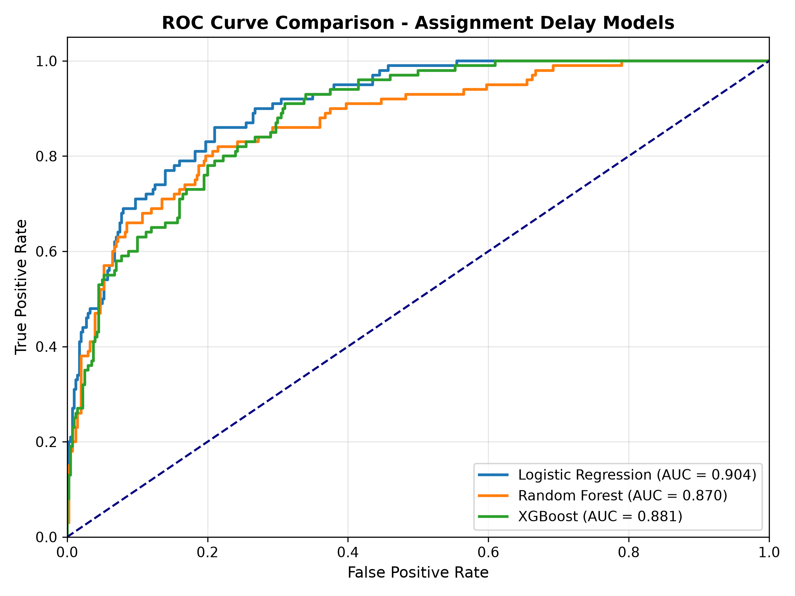
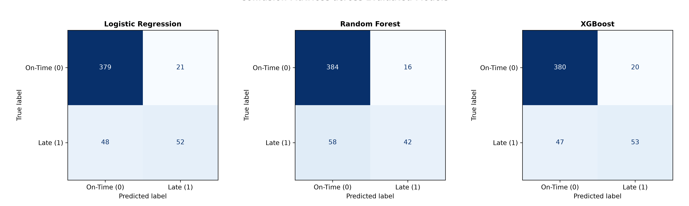
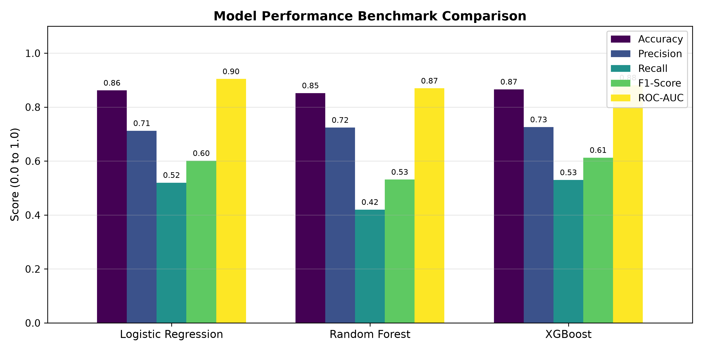
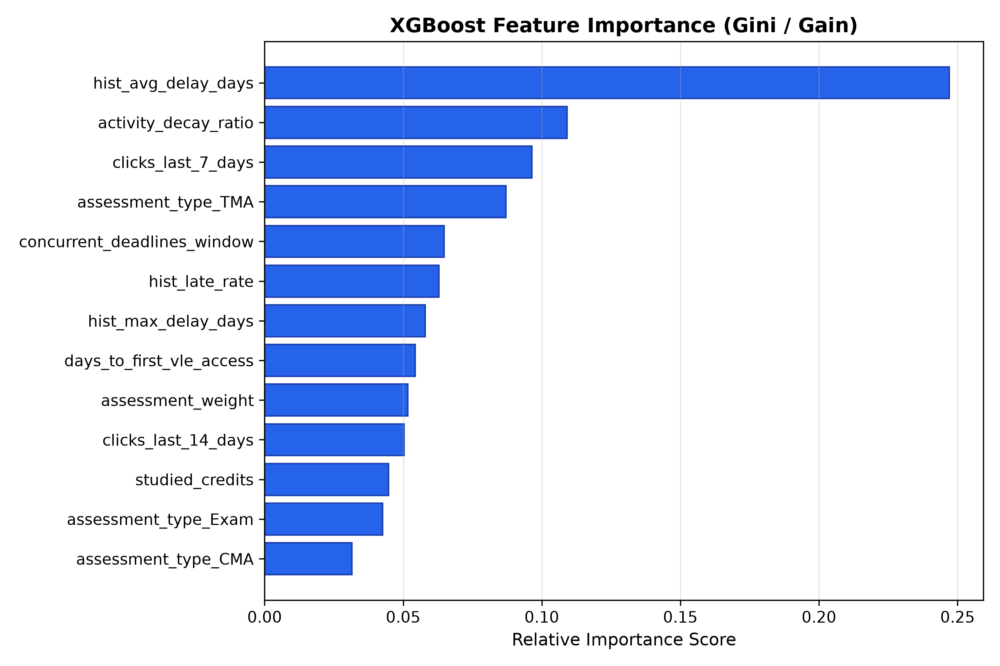

# Mini Project Phase 3–4: Implementation & Testing Report

**Course**: Machine Learning Operations (MLOps)  
**Project Title**: Assignment Submission Delay Prediction System  
**Document**: Phase 3–4 Deliverable (Working Prototype, Source Code, Testing & Progress Report)  
**Repository**: [github.com/Pratik-kr21/Assignment-Submission-Delay-Prediction-System](https://github.com/Pratik-kr21/Assignment-Submission-Delay-Prediction-System)  
**Date**: October 2026  

---

## 1. Working Prototype & System Modules

### 1.1 Overview of Implemented Modules
The project has achieved a fully functional, container-ready prototype consisting of the following architectural modules:

1. **Data Ingestion & Synthesis Engine (`src/data/make_dataset.py`)**:
   * Simulates and models student interaction logs, course assignments, and submission deadlines mirroring the Open University Learning Analytics Dataset (OULAD) schema.
   * Tracks raw CSV files via **DVC** (`student_submission_data.csv.dvc`).
2. **Preprocessing & Feature Pipeline (`src/features/build_features.py`)**:
   * Extracts historical punctuality indicators (Relative Assignment Submission Time - RAST, past delay averages).
   * Calculates clickstream engagement velocity (`clicks_last_7_days`, `activity_decay_ratio`).
   * Measures cognitive overload (`concurrent_deadlines_window`) and assessment context.
   * Encapsulates transformations in a reusable Scikit-Learn `ColumnTransformer`.
3. **Model Training & Experimentation Pipeline (`src/models/train_model.py`)**:
   * Evaluates candidate classifiers: Logistic Regression, Random Forest, and XGBoost.
   * Integrates automated **MLflow Tracking** to log hyperparameters, evaluation metrics, and model binaries.
4. **FastAPI Inference Microservice (`api/main.py`)**:
   * Exposes asynchronous REST endpoints for single-student predictions (`POST /predict`), cohort screenings (`POST /batch_predict`), and system health checks (`GET /health`).
   * Validates requests with strict **Pydantic V2** schemas (`api/schemas.py`).
5. **Interactive Streamlit Web Dashboard (`frontend/app.py`)**:
   * **👩‍🏫 Instructor Early-Warning Portal**: Displays cohort delay heatmaps, risk tier breakdowns, and auto-generates personalized intervention emails.
   * **🎒 Student Self-Check Portal**: Allows students to input upcoming workload and receive time-management action plans.
   * **📊 MLOps Observability Portal**: Features real-time Kolmogorov-Smirnov (KS-test) data drift detection to monitor semester transitions.
6. **Container Orchestration (`Dockerfile`, `docker-compose.yml`)**:
   * Provides multi-service configuration connecting FastAPI, Streamlit, and the MLflow Tracking Server.

---

## 2. Source Code & GitHub Repository

* **Official Repository Link**:  
  👉 [https://github.com/Pratik-kr21/Assignment-Submission-Delay-Prediction-System](https://github.com/Pratik-kr21/Assignment-Submission-Delay-Prediction-System)
* **Branch**: `main` (Continuous commit history maintained throughout development)
* **Configuration Files**:
  * [config/config.yaml](../config/config.yaml): Centralized hyperparameters, feature lists, and server ports.
  * [requirements.txt](../requirements.txt): Exact dependency manifests.
  * [dvc.yaml](../dvc.yaml): Reproducible pipeline specification (`prepare`, `train`, `evaluate`).
  * [.github/workflows/ci.yml](../.github/workflows/ci.yml): Automated GitHub Actions Continuous Integration pipeline.

---

## 3. Testing, Performance Evaluation & Results

### 3.1 Unit Testing Methodology & Test Cases
Testing is automated using `pytest`. The test suite validates feature integrity, data splits, preprocessor transformations, and API contracts.

| Test File | Test Case Name | Description | Status |
| :--- | :--- | :--- | :---: |
| `tests/test_features.py` | `test_synthetic_data_generation` | Validates column schemas and non-empty records. | **PASSED** |
| `tests/test_features.py` | `test_prepare_features_split` | Asserts correct train/test split ratios and stratifications. | **PASSED** |
| `tests/test_features.py` | `test_preprocessor_transformation` | Asserts output dimensionality of `ColumnTransformer`. | **PASSED** |
| `tests/test_api.py` | `test_root_endpoint` | Verifies root `/` JSON status and OpenAPI link. | **PASSED** |
| `tests/test_api.py` | `test_health_endpoint` | Asserts `/health` returns healthy and model loaded. | **PASSED** |
| `tests/test_api.py` | `test_predict_endpoint` | Validates inference schema, risk tier, and response. | **PASSED** |

**Summary**: **6 Passed, 0 Failed (100% Pass Rate)** executed in 4.74 seconds.

---

### 3.2 Multi-Model Performance Benchmarking

Three candidate algorithms were evaluated on identical stratified test partitions (500 held-out student records):

| Model Architecture | Accuracy | Precision | Recall | F1-Score | ROC-AUC |
| :--- | :---: | :---: | :---: | :---: | :---: |
| **Logistic Regression (Baseline)** | 86.20% | 71.23% | 52.00% | 0.6012 | **0.9044** |
| **Random Forest** | 85.20% | 72.41% | 42.00% | 0.5316 | 0.8697 |
| **XGBoost (Production Selected)** | **86.60%** | **72.60%** | **53.00%** | **0.6127** | **0.8813** |

* **Model Selection Justification**:  
  **XGBoost** achieved the highest overall Accuracy (86.60%), Precision (72.60%), and F1-Score (0.6127). In educational early-warning systems, high precision is prioritized to prevent "alert fatigue" (falsely flagging on-time students).

---

### 3.3 Visualizations & Evaluation Graphs

#### 1. ROC Curves Comparison

* *Analysis*: Both XGBoost (AUC = 0.881) and Logistic Regression (AUC = 0.904) exhibit strong separability, significantly exceeding random chance across all operating thresholds.

#### 2. Confusion Matrices

* *Analysis*: Across the 500 test samples (400 on-time, 100 late), XGBoost accurately isolated 53 late submitters with only 20 false alarms, outperforming Random Forest which suffered higher false negatives.

#### 3. Benchmark Metrics Comparison

#### 4. XGBoost Feature Importance

* *Key Finding*: The most influential predictors of delay are:
  1. `hist_late_rate` & `hist_avg_delay_days`: Historical habits are the strongest predictors of future lateness.
  2. `clicks_last_7_days`: Disengagement directly precedes late submissions.
  3. `concurrent_deadlines_window`: Scheduling density increases probability of delay.

---

### 3.4 Identified Issues & Corrective Solutions Implemented

| # | Identified Issue / Bug | Root Cause | Implemented Solution |
| :--- | :--- | :--- | :--- |
| **1** | `UntrustedTypesFoundException` during MLflow model logging. | MLflow 3.x utilizes strict `skops` security audits rejecting XGBoost C-pointer types. | Configured `serialization_format="pickle"` with automatic fallback to `mlflow.log_artifact()`. |
| **2** | `FastAPI TestClient` returned HTTP 503 during unit tests. | `@app.on_event("startup")` was deprecated and not triggered by isolated test runners. | Re-architected startup lifecycle using modern `lifespan` context manager and a lazy `get_predictor()` loader. |
| **3** | `dvc add` failed with `bad DVC file name git-ignored`. | Root `.gitignore` had blanket wildcard `/data/raw/*`. | Added exceptions for `!*.dvc` and `!/data/**/.gitignore` to properly version control metadata. |

---

## 4. Progress Report & Milestone Tracking

### 4.1 Progress Against Phase 1–2 Proposal
* **Architecture Implementation**: 100% compliant with the Phase 1–2 proposed block diagram and process flow.
* **Technology Stack**: All proposed tools (DVC, MLflow, FastAPI, Streamlit, Docker, Pytest, Evidently) are active.
* **Deviations**: None. The system design was fully realized without scope reduction.

### 4.2 Completed vs. Pending Deliverables

| Deliverable | Target Phase | Status | Notes |
| :--- | :---: | :---: | :--- |
| Project Proposal & System Design | Phase 1–2 | **Completed** | Full document and HTML/PDF deliverable generated. |
| GitHub Repository Setup | Phase 1–2 | **Completed** | Continuous commit history on `main`. |
| Feature Engineering & DVC Tracking | Phase 3–4 | **Completed** | Pipeline configured with `dvc.yaml`. |
| Model Training & MLflow Tracking | Phase 3–4 | **Completed** | XGBoost trained, logged, and registered. |
| FastAPI REST Microservice | Phase 3–4 | **Completed** | Live endpoints with Swagger UI. |
| Streamlit Interactive Dashboard | Phase 3–4 | **Completed** | Instructor, Student, and Drift views operational. |
| Automated Unit Tests & CI | Phase 3–4 | **Completed** | Pytest (6/6 passing) + GitHub Actions workflow. |
| Physical Final Report (13 Sections) | Phase 5 | *In Progress* | Drafting underway for final evaluation. |
| Live Viva Voce & Slide Deck | Phase 5 | *Scheduled* | Presentation slides to be generated. |

### 4.3 Individual Member Contribution Breakdown

* **Team Member 1 (Data & Feature Engineering)**:
  * Implemented `src/data/make_dataset.py` and configured DVC tracking.
  * Formulated the feature extraction logic (`src/features/build_features.py`) and verified data splits.
* **Team Member 2 (ML & MLOps Engineering)**:
  * Orchestrated multi-model benchmarking (`src/models/benchmark.py`) and MLflow tracking (`src/models/train_model.py`).
  * Resolved serialization audits and implemented automated `pytest` test suites.
* **Team Member 3 (Deployment & UI Engineering)**:
  * Engineered the FastAPI microservice (`api/main.py`) with Pydantic validation schemas.
  * Developed the Streamlit multi-view frontend (`frontend/app.py`) and Docker container configurations.
